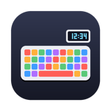
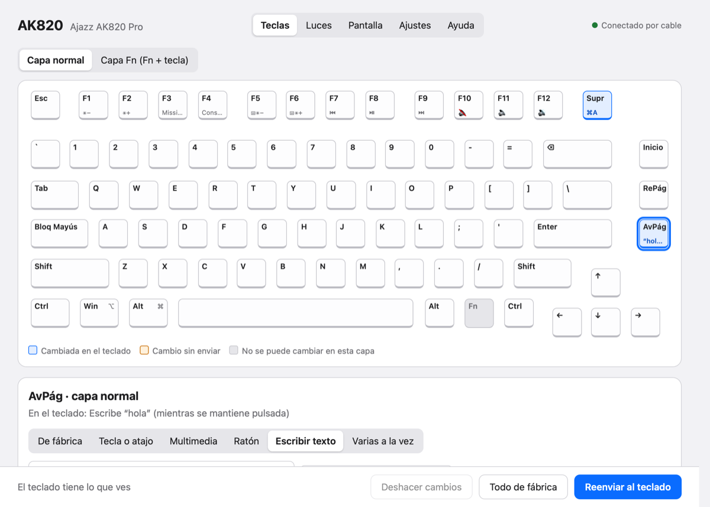
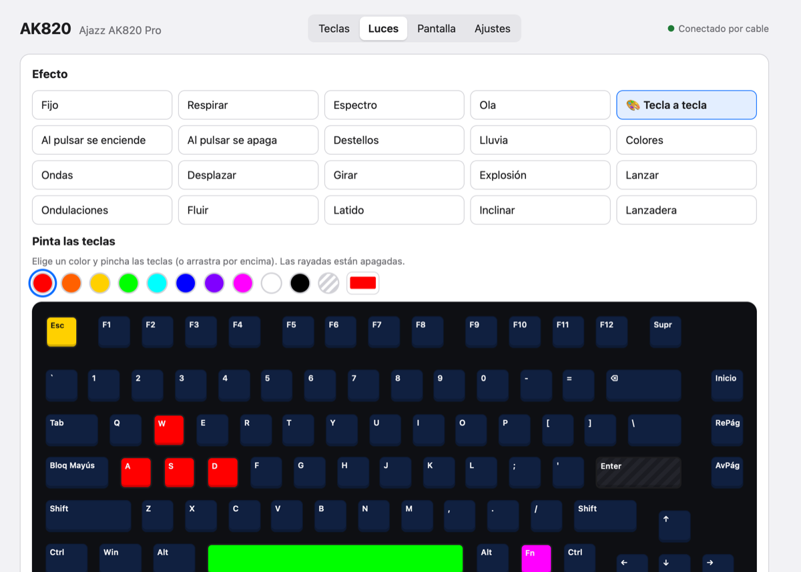
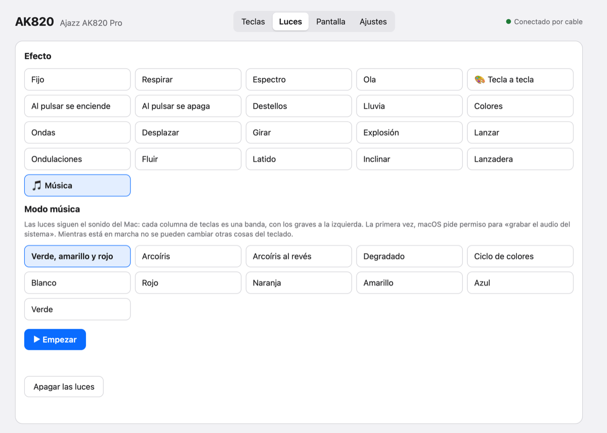

<p align="center"></p>

# ak820-mac

**A macOS app for the Ajazz AK820 Pro keyboard** (the one with the little screen). The
official configuration software only exists for Windows; this one was made by
reverse-engineering it, and covers what you'd actually use it for: keys, macros, lights,
the screen and music mode.

*[Leer en español](README.es.md)*



## What it can do

- **Keys**: remap any key, on the normal layer or the Fn layer: another key, a shortcut
  (⌘C…), media keys, mouse clicks and wheel, text macros (once, N times, while held,
  toggle…) or several keys at once. The keyboard stores it, so it works on any computer.
- **Lights**: all 19 built-in effects with color, brightness, speed and direction;
  **per-key colors** (paint the keys on a drawing of the keyboard); and a **music mode**
  where the keys become an equalizer that follows whatever your Mac is playing.
- **Screen**: put any picture or **animated GIF** on the 0.85" screen (cropped to
  128×128, up to 140 frames), see what's on it, or go back to the clock.
- **Clock**: sets the time automatically when the keyboard is plugged in.
- **Settings**: Fn key mode, sleep timer, key response time.
- **Without the cable**: lights, keys, macros, settings and the clock also work through
  the **2.4 GHz receiver**.

It comes as a menu-bar app with its own window, and as a command-line tool.

| Per-key colors | Music mode |
|---|---|
|  |  |

## Compatibility

- **Keyboard**: Ajazz AK820 Pro, wired USB IDs `0C45:8009` / `0C45:800A` with the vendor
  interface `0xFF13` (run `python3 ak820.py buscar` to check), and its 2.4 GHz receiver
  (`0C45:FDFD`). Some newer AK820 Pro firmwares use a different protocol and won't be
  detected. Bluetooth can't be used to configure anything.
- **Layout**: the key drawing is the ANSI (US) one from the official software. ISO
  keyboards may have one or two keys in different places.
- **Mac**: tested on Apple Silicon with macOS 26. You build it on your own Mac, so Intel
  should work too. Music mode needs **macOS 14.2** or later; the rest should also work
  on older versions.
- **Language**: the app is in Spanish for now (translations welcome).

## Installation

You need the Xcode **Command Line Tools** (they bring Python 3 and the Swift compiler). If
you don't have them, `python3` in the Terminal will offer to install them.

```sh
git clone https://github.com/gha-projects/ak820-mac.git
cd ak820-mac
python3 -m venv .venv
.venv/bin/pip install -r requirements-app.txt
./crear-app.sh
```

`crear-app.sh` builds **AK820.app**, copies it to Applications and opens it. Open it
like any other app from then on. To start it at login: System Settings → General →
Login Items. After changing the code, run `./crear-app.sh` again.

The first time you use music mode, macOS asks for permission to **record system audio**
(audio only, not the screen).

## Using it

- **The app**: the window opens when you start AK820, with four tabs: **Teclas** (keys),
  **Luces** (lights), **Pantalla** (screen) and **Ajustes** (settings). The ⌨︎ icon in the
  menu bar has quick actions too (lights, music mode, clock, sleep…). While it's busy the
  icon shows `⌨︎…`, `⌨︎ 45 %` or `⌨︎ ♪`.
- **The command line** (from the project folder):

  ```sh
  source .venv/bin/activate
  python3 ak820.py buscar                              # is the keyboard there?
  python3 ak820.py reloj                               # set the clock
  python3 ak820.py luces respirar --color 8000FF       # an effect (see: luces --help)
  python3 ak820.py colores esc=FF0000 --fondo 102040    # per-key colors
  python3 ak820.py musica --modo arcoiris               # music mode, until Ctrl+C
  python3 ak820.py imagen ~/Desktop/anim.gif            # picture or GIF on the screen
  python3 ak820.py teclas avpag=cmd+a repag=texto:Hi    # remap keys (see: teclas lista)
  python3 ak820.py teclas restaurar todo               # all keys back to factory
  python3 ak820.py sistema --fn-modo alternar          # settings (see: sistema --help)
  ```

The keyboard doesn't let you read its configuration back, so the program remembers
what it last sent in `~/Library/Application Support/ak820-mac/` (keys, colors, lights,
settings and a copy of the screen image).

## How it works

Everything was worked out from the official Windows driver (`DeviceDriver.exe`
v1.0.0.5), statically, without running it, plus a lot of trial and error with the
keyboard. The keyboard is configured with 64-byte HID feature reports (images go
through a second interface in 4 KB blocks); the 2.4 GHz receiver uses 32-byte reports.
Every format is documented in **[docs/PROTOCOL.md](docs/PROTOCOL.md)**.

The project is a few Python files with no framework:

| File | What it is |
|---|---|
| `ak820.py` | The protocol and the command-line tool |
| `ak820_app.py` | The menu-bar app ([rumps](https://github.com/jaredks/rumps)) |
| `ak820_ventana.py`, `ak820_editor.py`, `editor/` | The window: a local web page in a WKWebView, served on `127.0.0.1` with a random key |
| `musica/espectro.swift` | Listens to system audio (Core Audio tap) and prints a 21-band spectrum |
| `setup.py`, `crear-app.sh`, `app/` | Building `AK820.app` with py2app |
| `tests/` | Tests against a fake keyboard: `.venv/bin/python -m unittest discover -s tests` |
| `extras/` | Optional macOS remaps (Right Ctrl → 🌐 Globe, Home → F13) and a launcher for development |

## Credits

Part of the protocol was first decoded by the community, in MIT-licensed projects:
[gohv/EPOMAKER-Ajazz-AK820-Pro](https://github.com/gohv/EPOMAKER-Ajazz-AK820-Pro),
[TaxMachine/ajazz-keyboard-software-linux](https://github.com/TaxMachine/ajazz-keyboard-software-linux),
[Aiacos/ajazz-control-center](https://github.com/Aiacos/ajazz-control-center) and
[gusleig/ajazz-ak820-pro-mac](https://github.com/gusleig/ajazz-ak820-pro-mac).

MIT license (see [LICENSE](LICENSE)). Unofficial project, not affiliated with Ajazz or Epomaker. Use at your own risk: it
writes to the keyboard's memory (everything can be reset to factory from the app).
